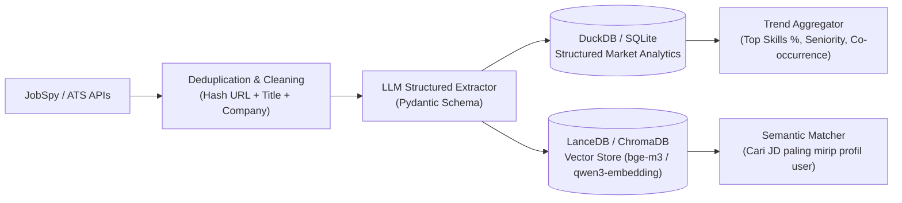

# 01. Data Strategy: Job Market Intelligence & Career Ground Truth

Agar AI Agent tidak sekadar memberi saran CV yang generik (seperti nasihat lama dari data training LLM), sistem harus memiliki **dua pilar data yang terpisah tetapi saling terhubung**:
1. **External Market Data:** Data lowongan kerja (*Job Description* / JD) aktual dari pasar kerja saat ini.
2. **Internal User Data (Master Career Profile):** Data fakta pengalaman, proyek, dan skill milik user sebagai *Single Source of Truth*.

---

## 1. Sumber Data Kondisi Job Market (Eksternal)

Ada tiga lapis sumber data yang bisa dikombinasikan untuk mendapatkan gambaran job market yang akurat (baik pasar Indonesia/SEA maupun Global/Remote):

### A. Open-Source Multi-Board Aggregator (`python-jobspy`)
`python-jobspy` adalah library Python open-source paling populer saat ini untuk menarik data lowongan lintas platform secara serentak ke format Pandas DataFrame / CSV / JSONL.
- **Platform yang didukung:** LinkedIn, Indeed, Glassdoor, ZipRecruiter, **SEEK (termasuk JobStreet & JobsDB untuk Indonesia/SEA)**, Google Jobs, dll.
- **Kelebihan:** Cepat untuk prototyping, skema kolom sudah seragam (`title`, `company`, `location`, `description`, `date_posted`, `min_amount`, `max_amount`, `job_url`), mendukung filter recency (`hours_old=168` untuk 7 hari terakhir).
- **Keterbatasan:** Platform seperti LinkedIn dan Indeed memiliki *rate-limit* dan anti-bot yang ketat. Jangan menjalankan scraping masif secara *real-time* di setiap chat user—gunakan pola **batch ingestion + cache lokal**.

### B. Direct ATS Feeds (Lebih Stabil & Data Lebih Bersih)
Alih-alih hanya mengandalkan job board publik, banyak perusahaan teknologi memublikasikan lowongan mereka lewat endpoint publik milik sistem ATS (Applicant Tracking System):
- **Greenhouse** (`boards-api.greenhouse.io/v1/boards/{company}/jobs?content=true`)
- **Lever** (`api.lever.co/v0/postings/{company}`)
- **Ashby** & **SmartRecruiters**
- **Kelebihan:** Format JSON terstruktur, minim risiko blokir CAPTCHA, deskripsi pekerjaan lengkap dan jarang terpotong, serta cocok jika user punya daftar perusahaan target (*target companies*).

### C. Public Job APIs & Portal Lokal Indonesia
- **Global / Remote APIs:** Remotive API, Arbeitnow API, Adzuna API, Jooble API (menyediakan tier gratis dengan registrasi API key).
- **Pasar Indonesia / SEA:** JobStreet (tercakup via SEEK di `python-jobspy`), LinkedIn Indonesia (`location="Indonesia"`), serta eksplorasi portal lokal seperti Glints / Kalibrr / Dealls jika dibutuhkan (dengan memperhatikan ToS dan rate limiting).

### D. Knowledge Base Standar & Taksonomi Skill (Data Referensi Statis/Semi-Statis)
Agar agent paham sinonim dan hierarki skill (misal: `PySpark` berelasi dengan `Apache Spark` dan `Big Data`; `BigQuery` adalah `Cloud Data Warehouse`):
- **ESCO (European Skills, Competences, Qualifications and Occupations)** atau **O*NET** (tersedia gratis dalam format CSV/JSON) sebagai kamus taksonomi skill.
- **Custom Skill Normalization Dictionary (`skills_taxonomy.yaml`):** Kamus buatan sendiri untuk memetakan variasi penulisan teknologi (misal: `k8s` -> `Kubernetes`, `dbt core` -> `dbt`, `gcp bq` -> `Google BigQuery`).

---

## 2. Sumber Data User (Internal Ground Truth)

Masalah terbesar AI pembuat CV adalah **halusinasi** (mengarang pengalaman kerja atau angka persentase yang tidak pernah dilakukan user). Solusinya adalah memisahkan **Master Profile** dari **Tailored CV**.

### A. Ingestion dari CV Lama (PDF/DOCX Parsing)
Ketika user pertama kali mengunggah CV lama (sering kali dalam format PDF 2 kolom, sidebar, atau template Canva), parser teks biasa sering mengacak urutan baca.

| Tool Lokal | Arsitektur | Kecepatan | Layout Multi-Kolom / Sidebar | Rekomendasi |
| :--- | :--- | :--- | :--- | :--- |
| **PyMuPDF4LLM** | C-engine (MuPDF) + heuristik layout | Sangat cepat (milidetik) | Bagus untuk layout standar & 2 kolom rapi | **Default utama** (ringan, tanpa download model besar). |
| **Docling (IBM)** | Deep Learning (layout & table AI model) | Sedang (1–3 detik/CV) | **Sangat akurat** untuk CV visual/sidebar rumit | **Fallback** jika hasil PyMuPDF4LLM terlihat berantakan/teracak. |
| **MarkItDown** | Ekstraksi teks dasar | Sangat cepat | Kurang baik untuk PDF multi-kolom | Hanya dipakai jika input berupa `.docx`. |

### B. `master_profile.yaml` (Single Source of Truth)
Hasil parsing CV lama (plus opsional data dari profil GitHub README / proyek lokal / wawancara interaktif dengan user) dikonversi menjadi satu file **Master Profile** yang memuat **semua** fakta karier user secara lengkap (boleh lebih dari 2 halaman—tidak dibatasi panjang CV).
- Setiap klaim pengalaman diberi `id` unik (misal `exp_01_b2`, `proj_03_b1`).
- Setiap angka/metrik yang divalidasi user diberi tanda status (`verified: true`).
- Ketika membuat CV untuk role tertentu, Agent hanya boleh **memilih, menyusun ulang, dan memoles kalimat** dari fakta yang ada di `master_profile.yaml`.

---

## 3. Arsitektur Data & Storage Lokal (Hybrid Analytics + Vector)

Jangan hanya mengandalkan Vector DB (RAG) untuk menganalisis job market! Vector DB **tidak bisa menghitung agregasi** seperti *"Berapa persen lowongan Data Engineer di Jakarta bulan ini yang mewajibkan dbt atau Airflow?"*.

Gunakan arsitektur **Dual-Store Lokal** (ringan, *embedded*, tanpa perlu install server database terpisah):

### A. Structured Analytical Store (`DuckDB` atau `SQLite`)
Menyimpan data mentah JD dan hasil ekstraksi terstruktur untuk analitik kuantitatif:
- **Tabel `job_postings`:** `job_id`, `source`, `title`, `normalized_role`, `company`, `location`, `work_mode` (remote/hybrid/onsite), `seniority` (junior/mid/senior), `salary_min`, `salary_max`, `currency`, `posted_at`, `scraped_at`, `raw_description`.
- **Tabel `job_skills`:** `job_id`, `skill_name`, `skill_normalized`, `category` (language, orchestration, warehouse, cloud, soft_skill), `requirement_level` (`mandatory` vs `nice_to_have`).
- **Tabel `market_snapshots`:** Hasil agregasi per role & periode waktu (misal: *"Data Engineer - ID - Nov 2026: SQL 96%, Python 92%, Airflow 68%, dbt 54%, Spark 51%, BigQuery 44%"*).

### B. Vector Store Lokal (`LanceDB` atau `ChromaDB`)
Menyimpan embedding dari deskripsi pekerjaan dan potongan proyek/pengalaman user:
- Digunakan untuk **Semantic Gap Matching**: mencari proyek user mana yang paling relevan dengan tanggung jawab di JD target, meskipun istilah yang dipakai sedikit berbeda (misal: user menulis *"pipeline ingest data harian dari API ke BigQuery"*, JD mencari *"automated ELT data ingestion into cloud data warehouse"*).
- **Kenapa LanceDB?** Serverless (file-based seperti DuckDB), mendukung *hybrid search* (dense vector + full-text BM25), dan integrasi mulus dengan Pandas/PyArrow.

---

## 4. Pipeline Ekstraksi & Data Freshness

Agar data selalu segar tanpa memboroskan waktu inferensi local LLM:

1. **Deduplikasi Cerdas:** Hitung fingerprint (`sha256(company + normalized_title + first_300_chars_jd)`) sebelum masuk ekstraksi LLM agar lowongan yang diposting ulang di LinkedIn & Indeed tidak dihitung ganda.
2. **Two-Stage Skill Extraction (Hemat Waktu GPU Lokal):**
   - *Stage 1 (Rule-based / Regex / Aho-Corasick):* Ekstrak cepat keyword teknis dari `skills_taxonomy.yaml` dalam milidetik (akurasi tinggi untuk nama tools seperti `dbt`, `Airflow`, `Iceberg`, `Kafka`).
   - *Stage 2 (Local LLM Structured Extraction):* Hanya dipakai untuk mengekstrak nuansa yang tidak bisa ditangkap regex: tingkat senioritas, `mandatory` vs `preferred`, ekspektasi *scale/impact*, dan *domain* (fintech, e-commerce, FMCG).
3. **Caching & TTL Policy:**
   - Snapshot job market per `(role, location)` di-cache selama **7–14 hari**.
   - Jika user menanyakan *"Kondisi market Data Engineer sekarang gimana?"*, agent mengecek cache DuckDB dulu; jika stale (>7 hari) atau user meminta refresh, barulah tool `fetch_market_jobs` dijalankan.
4. **Privasi Total:** Karena seluruh data CV user, database DuckDB, Vector DB, dan LLM berjalan 100% lokal, PII (nomor HP, alamat, gaji, nama perusahaan lama) tidak pernah bocor ke server pihak ketiga.
