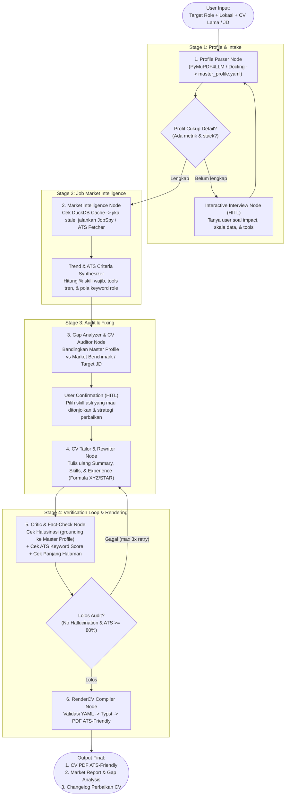

# 03. Arsitektur & Workflow AI Agent

Agar AI Agent mampu bertindak layaknya *career coach + technical recruiter + ATS engineer* yang disiplin—bukan chatbot yang asal mengarang—workflow harus dirancang sebagai **Stateful Graph dengan Verification Loop dan Human-in-the-Loop (HITL)**.

---

## 1. Perbandingan Agent Framework untuk Local LLM

| Framework | Paradigma | Kecocokan dengan Local LLM | Kelebihan Utama | Kekurangan |
| :--- | :--- | :--- | :--- | :--- |
| **LangGraph** | Stateful Directed Cyclic Graph (Node & Edge) | **Sangat Baik** | Kontrol penuh atas alur, mendukung *cyclic critic loop*, *checkpointing/resume* (aman jika proses lokal terputus), dan *Human-in-the-Loop* (`interrupt()`). | Boilerplate sedikit lebih banyak dibanding CrewAI. |
| **PydanticAI** | Type-safe Python Agent + Dependency Injection | **Sangat Baik** | Validasi skema ketat menggunakan Pydantic; jika local LLM salah format JSON/argumen tool, PydanticAI **otomatis mengirim pesan error balik ke LLM untuk self-correction**. | Tidak membawa state-machine graf sekompleks LangGraph secara default (walau kini ada `pydantic-graph`). |
| **CrewAI** | Role-based Multi-Agent Team | **Sedang** | Cepat untuk prototyping tim agent (Researcher, Writer, Reviewer). | Model lokal < 32B sering kebingungan menjaga persona dan gagal *handoff* antar-agent, memicu loop tak berujung. |

### Rekomendasi Arsitektur Framework
Gunakan **kombinasi LangGraph + Pydantic** (atau **LangGraph sebagai orchestrator alur** + **PydanticAI untuk tiap node yang butuh structured output/tool calling**):
- **LangGraph** mengatur alur besar, penyimpanan state antar-sesi (SQLite checkpointer), retry loop, dan jeda interaktif dengan user.
- **Pydantic** menjamin setiap pertukaran data antar-node (profil user, laporan gap analysis, draft YAML RenderCV, hasil fact-check) 100% tervalidasi tipenya.

---

## 2. Alur Workflow End-to-End (Multi-Stage Agentic Graph)

---

## 3. Detail Peran Setiap Node / Sub-Agent

### Node 1: Profile Intake & Interactive Interviewer (HITL)
- **Input:** PDF/DOCX CV lama user, atau input teks bebas / link repo GitHub.
- **Tugas:** Mengubah CV mentah menjadi `master_profile.yaml` terstruktur.
- **Kunci Pintar (Interview Mode):** Banyak kandidat (termasuk *Data Engineer*) hanya menulis *"Membuat ETL pipeline dengan Python"* tanpa angka dampak. Node ini mendeteksi bullet yang lemah lalu bertanya secara spesifik ke user:
  - *"Di proyek ETL di PT X, kira-kira berapa volume data yang diproses per hari (GB/juta baris)?"*
  - *"Apakah pipeline tersebut mempercepat waktu reporting atau menghemat biaya cloud?"*
  - *"Apakah kamu menggunakan orchestrator (Airflow/Dagster/Cron) dan testing?"*
- Jawaban user langsung disimpan ke `master_profile.yaml` agar tidak perlu ditanya ulang di masa depan.

### Node 2: Job Market Intelligence Agent
- **Tools yang dimiliki:**
  - `check_market_cache(role, location, max_age_days=7)` -> query DuckDB.
  - `scrape_recent_jobs(role, location, limit=50)` -> panggil `python-jobspy` / ATS APIs.
  - `analyze_market_trends(role, location)` -> jalankan SQL agregasi di DuckDB untuk menghasilkan:
    - **Core / Must-Have Skills** (muncul di >50% JD).
    - **Rising / Differentiator Skills** (muncul di 20–50% JD dan sedang naik tren).
    - **Common Responsibilities & Seniority Signals** (ekspektasi level Junior vs Mid vs Senior).
    - **ATS Exact Phrase List** (frasa persis yang sering muncul, misal `"Apache Airflow"`, `"dimensional modeling"`, `"data quality"`).
- **Mode Ganda:**
  1. **Market-Wide Mode:** User ingin CV yang optimal secara umum untuk kondisi market saat ini (misal: *"Data Engineer di Indonesia / Remote SEA"*).
  2. **Targeted JD Mode:** User menempelkan 1 link/teks lowongan spesifik -> Agent menggabungkan benchmark market + prioritas tinggi ke keyword di JD tersebut.

### Node 3: Gap Analyzer & CV Auditor
Menghasilkan **Diagnostic Report** sebelum mulai menulis ulang CV:
- **ATS Structural Audit:** Apakah CV lama pakai 2 kolom/tabel/grafik skill bar? Apakah urutan kronologis benar? Apakah panjangnya melewati 1–2 halaman?
- **Skill Gap Matrix:**
  - *Matched Skills (Sudah ada di CV & dicari market)* -> Pertahankan & tonjolkan.
  - *Hidden Skills (Ada di Master Profile / pernah dipakai user, tapi belum tertulis jelas di CV)* -> **Quick Win** untuk langsung dimasukkan.
  - *True Gaps (Dicari market, tapi user memang belum pernah pakai)* -> **Dilarang dimasukkan ke CV!** Alih-alih mengarang, Agent memasukkannya ke bagian **"Rekomendasi Upskilling / Ide Portfolio Project"**.
- **Bullet Quality Audit:** Menandai bullet yang masih deskriptif (*"Responsible for..."*) agar diubah menjadi *impact-driven* (formula XYZ/STAR).

### Node 4: CV Tailor & Rewriter
- Mengambil `master_profile.yaml` + hasil persetujuan user + target ATS keywords.
- Menulis ulang:
  1. **Professional Summary** (3–4 baris padat yang mencerminkan posisi target, tahun pengalaman, stack utama, dan dampak bisnis).
  2. **Grouped Technical Skills** (dikelompokkan berdasarkan kategori industri agar mudah dipindai recruiter dalam 6 detik).
  3. **Experience & Project Bullets** dengan menyisipkan **source trace** (`source_id: "exp_01_b2"`) di metadata sementara agar bisa diverifikasi oleh Critic Node.

### Node 5: Fact-Check & ATS Critic Loop (Anti-Halusinasi)
Ini pembeda utama antara agent serius dan prompt generik. Sebelum PDF dicetak, Critic Node menjalankan **2 lapis pemeriksaan**:
1. **Deterministic Python Checks (Tanpa LLM — 100% akurat):**
   - Apakah semua nama tools/teknologi di draft CV eksis di `master_profile.yaml`?
   - Apakah semua angka/persentase/nominal di draft CV berasal dari `master_profile.yaml` (bukan dikarang LLM)?
   - Apakah jumlah kata per bullet <= 28–35 kata dan estimasi halaman sesuai target (1 halaman untuk <5 tahun pengalaman, 1–2 halaman untuk senior)?
   - Hitung skor kecocokan keyword (Exact Match + Semantic Cosine Similarity via `bge-m3`/`qwen3-embedding`).
2. **LLM Critic Review:**
   - Cek apakah ada *buzzword kosong* (*"hardworking team player"*), pengulangan kata kerja (*action verbs*), atau tata bahasa yang kaku.
- Jika ada pelanggaran (misal LLM diam-diam menambahkan `Kubernetes` padahal tidak ada di `master_profile.yaml`), Critic Node menolak draft dan mengembalikan feedback spesifik ke Node 4 untuk diperbaiki otomatis (maksimal 3 iterasi).

### Node 6: Document Compiler (RenderCV / Typst)
- Mengonversi struktur CV tervalidasi menjadi file YAML sesuai skema **RenderCV**.
- Menjalankan `rendercv render` secara terprogram untuk menghasilkan:
  - File **PDF ATS-friendly** (teks vektor murni, bisa di-select & di-parse ATS tanpa rusak).
  - File **PNG Preview** (opsional bisa dilihat user atau diaudit visual oleh model multimodal seperti Gemma 3/4 untuk memastikan tidak ada *orphan line* atau halaman ke-2 yang cuma terisi 2 baris).
  - File **Markdown Changelog** yang menjelaskan *"Apa saja yang diperbaiki dan kenapa (berdasarkan data market)"*.
