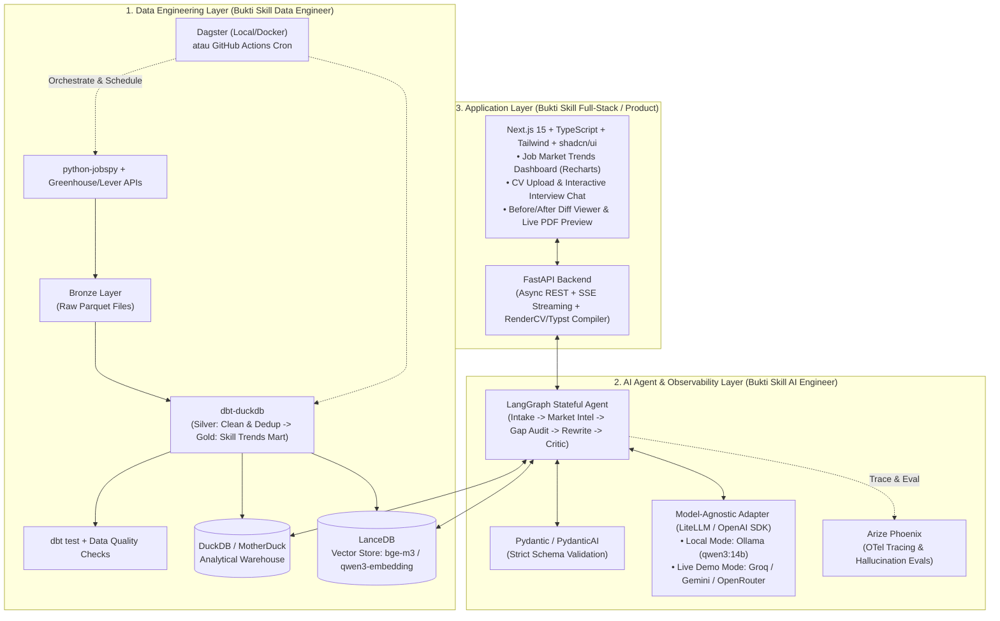

# 06. Portfolio-Grade Tech Stack Blueprint

Jika proyek ini ingin dijadikan **aplikasi portofolio nyata**, pemilihan tech stack tidak hanya soal "bisa jalan", tetapi harus menjadi **bukti konkret (engineering proof)** bahwa kamu menguasai arsitektur modern di dunia kerja—terutama untuk posisi **Data Engineer**, **AI Engineer**, atau **Full-Stack AI/Data Engineer**.

Konsep terbaiknya adalah **"Meta-Portfolio"**: kamu membangun aplikasi yang membantu mengoptimalkan CV berdasarkan tren pasar kerja *menggunakan* tech stack yang justru sedang dicari pasar kerja itu sendiri.

---

## 1. Apa yang Recruiter / Hiring Manager Cari di Proyek Portofolio?

Banyak portofolio AI gagal menonjol karena hanya berupa *wrapper* Streamlit + 1 prompt LLM. Agar proyekmu langsung naik kelas dibanding 95% portofolio lain, stack-mu harus membuktikan **5 pilar kompetensi**:

| Pilar Kompetensi | Apa yang Dinilai Hiring Manager | Bukti di Proyek Ini |
| :--- | :--- | :--- |
| **1. Modern Data Engineering** | Bukan sekadar script scraping sekali pakai—harus ada *data modeling*, *data quality*, dan *orchestration*. | **Medallion Architecture** (Bronze $\rightarrow$ Silver $\rightarrow$ Gold) dengan **DuckDB + `dbt-duckdb` + Dagster** (atau GitHub Actions scheduled ETL) + automated `dbt test`. |
| **2. Production AI Engineering** | Bukan sekadar chat—harus ada *stateful workflow*, *structured outputs*, *anti-hallucination guardrails*, dan *observability*. | **LangGraph + PydanticAI**, **LanceDB** Hybrid RAG, **Deterministic Fact-Checker**, dan **Arize Phoenix** (OpenTelemetry tracing + RAG/Hallucination evaluation). |
| **3. Full-Stack Product Engineering** | Aplikasi yang nyaman dipakai user nyata, bukan terminal mentah. | **FastAPI** (async + SSE streaming proses berpikir agent) + **Next.js (TypeScript, Tailwind, shadcn/ui)** dengan Market Dashboard, CV Diff Viewer, & Live PDF Preview. |
| **4. Software Quality & DevOps** | Reproducible, teruji otomatis, dan bersih. | **Docker Compose** (1 perintah jalan semua), **Pytest** (termasuk unit test anti-halusinasi), **Ruff/Mypy**, dan **GitHub Actions CI/CD**. |
| **5. Demo-ability (Bisa Dicoba Recruiter!)** | Recruiter **tidak akan** download Ollama 10 GB hanya untuk mencoba portofoliomu. | **Model-Agnostic Adapter** (`Ollama` untuk 100% lokal + switch `.env` ke cloud API murah/gratis untuk *Live Hosted Demo* di web). |

---

## 2. Arsitektur Portfolio-Grade (End-to-End)

---

## 3. Rincian Tech Stack Rekomendasi & Alasan Nilai Jualnya

### A. Data Engineering Stack (Sangat Kuat untuk Target Role Data Engineer)
| Komponen | Teknologi | Kenapa Ini Nilai Jual Besar di CV? |
| :--- | :--- | :--- |
| **Storage & Warehouse** | **DuckDB** (+ **Parquet** / opsional **MotherDuck** free tier) | Standar modern untuk *in-process analytics*; sangat cepat, nol biaya server, dan mendukung arsitektur lakehouse lokal. |
| **Transformation & DQ** | **`dbt-duckdb`** | **dbt** muncul di >50% lowongan Data Engineer. Menunjukkan kamu bisa menerapkan *Medallion Architecture* (`stg_jobs`, `int_extracted_skills`, `mart_role_skill_trends`) dan *automated testing* (`unique`, `not_null`, `accepted_values`). |
| **Orchestration** | **Dagster** *(pilihan utama)* atau **GitHub Actions Scheduled Workflow** | **Dagster** sangat disukai perusahaan modern karena *asset-based orchestration* & *asset checks*. Sebagai bonus, GitHub Actions cron bisa menjalankan pipeline scraping + dbt tiap minggu **secara gratis** tanpa perlu sewa VM 24/7! |
| **Vector Store** | **LanceDB** | Embedded, berbasis format columnar (Apache Arrow/Lance), mendukung *hybrid search* (vector + BM25). |

### B. AI Agent & Evaluation Stack (Bukti Skill AI / LLM Engineer)
| Komponen | Teknologi | Kenapa Ini Nilai Jual Besar di CV? |
| :--- | :--- | :--- |
| **Agent Orchestration** | **LangGraph** | Standar industri untuk agent *stateful*, *cyclic critic loop*, *checkpointing*, dan *Human-in-the-Loop*. |
| **Structured Validation** | **Pydantic v2 / PydanticAI** | Membuktikan kamu tidak membiarkan output LLM "liar"—semua tool call & output CV terikat kontrak skema yang ketat. |
| **LLM Abstraction** | **Ollama** (lokal) + **LiteLLM / OpenAI-compatible client** | Membuktikan arsitektur *vendor-agnostic*: 100% privat di lokal (`qwen3`), tetapi bisa langsung di-deploy sebagai demo publik tanpa ubah kode inti. |
| **Observability & Evals** | **Arize Phoenix** *(1 Docker container, ringan)* atau **Langfuse** *(MIT license)* | **Pembeda terbesar di portofolio AI!** Memperlihatkan screenshot *trace* latency per node, token usage, dan *hallucination evaluation score* di README GitHub langsung menandakan level *production engineer*. |
| **Document Engine** | **PyMuPDF4LLM / Docling** + **RenderCV (Typst)** | Menunjukkan kemampuan membangun pipeline *Document Intelligence* (PDF -> Structured Data -> Typeset PDF) secara terprogram. |

### C. Full-Stack Application & DevOps Stack
| Komponen | Teknologi | Kenapa Ini Nilai Jual Besar di CV? |
| :--- | :--- | :--- |
| **Backend API** | **FastAPI** (Python 3.12, `uv`, async + **Server-Sent Events / SSE**) | SSE streaming membuat UI bisa menampilkan progres real-time (*"1. Parsing CV... 2. Querying 120 Data Engineer JDs... 3. Running Fact-Check..."*). |
| **Frontend Web** | **Next.js (App Router, TypeScript)** + **Tailwind CSS** + **shadcn/ui** + **Recharts** | Tampilan jauh lebih profesional dibanding template Streamlit standar; membuktikan kemampuan membangun produk nyata. |
| **Packaging & CI** | **Docker & Docker Compose** + **GitHub Actions** + **Pytest** + **Ruff** | Recruiter/engineer lain bisa meninjau *automated tests*, linting, dan menjalankan sistem penuh secara reproducible. |

---

## 4. Fitur UI Wajib Agar Portofolio Terlihat "Wah"

Saat recruiter membuka demo atau video walkthrough 2 menit di README GitHub, 4 halaman ini akan langsung menjual kemampuanmu:

1. **Halaman 1 — Live Job Market Radar Dashboard:**
   - Filter berdasarkan role (*Data Engineer, Analytics Engineer, AI Engineer*) & wilayah (*Indonesia / Remote*).
   - Menampilkan grafik batang **Top Skills Demand (%)**, **Rising Skills**, jumlah sampel lowongan, dan tanggal *last refreshed* dari pipeline `dbt + DuckDB`.
2. **Halaman 2 — CV Audit & Gap Matrix:**
   - User upload PDF CV lama -> muncul **ATS Score**, **Matched Skills**, **Hidden Skills (Quick Wins)**, dan **True Gaps (Rekomendasi Belajar)** beserta penjelasan berbasis data aktual.
3. **Halaman 3 — Interactive AI Tailor & Side-by-Side Diff Viewer:**
   - Streaming langkah kerja agent (LangGraph nodes) secara real-time.
   - Panel kiri: *Bullet point CV lama*. Panel kanan: *Bullet point hasil perbaikan (XYZ format)* lengkap dengan **Source Badge** (menunjukkan bukti grounding ke fakta asli di `master_profile.yaml` agar tidak ada halusinasi).
4. **Halaman 4 — Live ATS PDF Preview & Export:**
   - Preview langsung hasil render **RenderCV (Typst)** di browser + tombol download `.pdf` dan `.yaml`.

---

## 5. Strategi Deployment Gratis / Murah untuk Live Demo Portofolio

Masalah klasik proyek *Local LLM* adalah tidak bisa dibuka lewat link URL oleh HRD/Tech Lead. Solusinya gunakan arsitektur **Hybrid Demo**:

- **Frontend (Next.js):** Deploy gratis di **Vercel**.
- **Analytical Data (DuckDB / Parquet):** Di-update otomatis setiap minggu oleh **GitHub Actions** (scraping JobSpy + ATS APIs + run `dbt-duckdb`), lalu di-upload ke **MotherDuck** (free tier) atau **Cloudflare R2 / GitHub Releases**. Jadi halaman *Job Market Dashboard* selalu hidup 24/7 dengan data segar!
- **Backend (FastAPI + LangGraph + RenderCV):** Deploy sebagai container Docker di **Render / Railway / Hugging Face Spaces**.
  - Set `DEMO_MODE=true` di production: menggunakan API gratis/murah (misalnya **Groq / Gemini / OpenRouter**) dengan *rate limit* per IP (misal 3x audit/hari) agar aman dari abuse.
  - Set `LLM_PROVIDER=ollama` di local `docker-compose.yml`: berjalan 100% offline dan privat untuk pemakaian pribadi.

---

## 6. Pilih Scope Sesuai Waktu yang Kamu Punya

Kalau kamu bingung harus mulai dari yang mana, ada 2 jalur yang sama-sama kuat:

| Jalur | Stack Inti | Estimasi Waktu | Paling Cocok Untuk |
| :--- | :--- | :--- | :--- |
| **Jalur 1: Full Flagship Portfolio** *(Paling Impresif)* | `Dagster` + `dbt-duckdb` + `DuckDB` + `LanceDB` + `LangGraph` + `PydanticAI` + `Arize Phoenix` + `FastAPI` + `Next.js (shadcn/ui)` + `RenderCV` + `Docker Compose` | 3–5 minggu (bertahap) | Melamar **Data Engineer**, **AI Engineer**, atau **Data/AI Platform Engineer** — jadi 1 proyek bintang utama (*crown jewel*) di GitHub & CV. |
| **Jalur 2: Lean High-Impact Portfolio** *(Cepat Rilis)* | `GitHub Actions Cron` + `DuckDB` + `LanceDB` + `LangGraph` + `FastAPI` + `Next.js` + `RenderCV` | 1–2 minggu | Ingin cepat punya live demo jalan dulu, lalu upgrade bertahap menambahkan `dbt-duckdb`, `Dagster`, & `Arize Phoenix` di versi v2. |

### Rencana Terpilih (Phased Upgrade: Jalur 2 $\rightarrow$ Flagship)
1. **Minggu 1–2 (Core App — Jalur 2):** Fokus membangun aplikasi end-to-end yang langsung bisa dipakai & di-demo (`python-jobspy` $\rightarrow$ Raw Parquet/DuckDB $\rightarrow$ LanceDB $\rightarrow$ LangGraph + Ollama/Cloud adapter $\rightarrow$ FastAPI + RenderCV $\rightarrow$ Next.js UI). Pastikan pemisahan folder `raw/` (Bronze) dan query agregasi SQL rapi sejak awal agar mudah dimigrasi ke `dbt-duckdb`.
2. **Minggu 3–4 (Data & AI Engineering Upgrade):**
   - Pindahkan transformasi SQL DuckDB ke project **`dbt-duckdb`** (Bronze $\rightarrow$ Silver $\rightarrow$ Gold + `dbt test`).
   - Bungkus pipeline scraping + dbt ke dalam **`Dagster`** software-defined assets & asset checks.
   - Pasang **`Arize Phoenix`** (OpenTelemetry tracing) untuk memantau performa LangGraph, debugging RAG, dan membuat laporan evaluasi anti-halusinasi.

---

## 7. Apa Itu Arize Phoenix?

**Arize Phoenix** adalah tool **AI Observability & Evaluation open-source** yang berfungsi layaknya *Grafana + Jaeger*, tetapi dibuat khusus untuk aplikasi LLM, RAG, dan AI Agent.

- **Kenapa berguna untuk proyek ini?**
  1. **Tracing per Langkah (OpenTelemetry):** Menampilkan *timeline* detail tiap node LangGraph—prompt apa yang dikirim ke Ollama, berapa detik tiap node berjalan, tool call apa yang dipanggil, dan apakah Critic Node sempat me-reject draft karena halusinasi.
  2. **RAG Debugging:** Membantu melihat dokumen JD mana yang diambil dari LanceDB dan seberapa tinggi skor kemiripannya.
  3. **Evaluasi Otomatis (LLM-as-a-Judge):** Menjalankan pengujian untuk mengukur metrik *Hallucination* dan *Relevance* secara kuantitatif (cocok di-screenshot sebagai bukti di README portofolio).
- **Kenapa pilih Phoenix dibanding Langfuse untuk lokal?**
  - **Arize Phoenix** sangat ringan: cukup 1 perintah Python (`pip install arize-phoenix` $\rightarrow$ `phoenix serve`) atau 1 Docker container.
  - **Langfuse** (MIT license) sangat bagus untuk skala produksi besar, tetapi self-hosting penuhnya membutuhkan multi-container (ClickHouse + Postgres + Redis + S3).

---

### Checklist "Proof Artifacts" Wajib di Repository GitHub
Agar nilai portofoliomu maksimal di mata interviewer, pastikan repository nanti memuat:
- [ ] **Architecture Diagram** yang rapi di `README.md` (menjelaskan Data Pipeline + Agent Graph + Anti-Hallucination Design).
- [ ] **Demo GIF / Video 60–90 detik** (upload CV -> audit -> diff before/after -> download PDF).
- [ ] **Engineering Decisions / ADR singkat** (kenapa pilih DuckDB + dbt dibanding Postgres biasa, kenapa pakai deterministic fact-checker, hasil benchmark evaluasi Arize Phoenix).
- [ ] **Live URL Demo** + **One-Command Local Setup (`docker compose up`)**.
