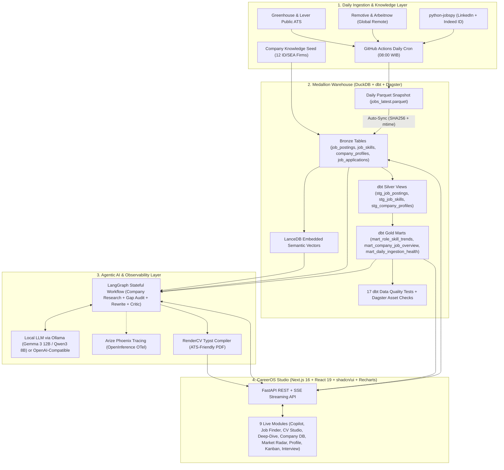
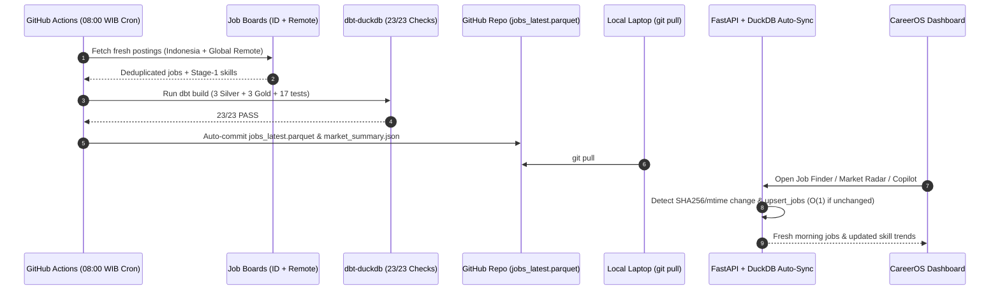

# CareerOS Studio — Local-First AI Agent for CV Optimization & Job Market Intelligence

[](https://github.com/ExHansen/cv-job-market-agent/actions/workflows/ci.yml)
[](https://github.com/ExHansen/cv-job-market-agent/actions/workflows/market-refresh.yml)


**CareerOS Studio** adalah platform **Data Engineering + Agentic AI** yang berjalan **100% lokal (privacy-first)** untuk:
1. Mengumpulkan data lowongan kerja aktual (**Indonesia + Global Remote**) secara otomatis setiap hari pukul **08:00 WIB** via GitHub Actions dan mengolahnya menjadi **Medallion Data Warehouse** (`Bronze -> Silver -> Gold`) menggunakan **DuckDB, dbt-duckdb, dan Dagster**.
2. Menjalankan **AI Agent berbasis LangGraph + Local LLM (Ollama)** untuk analisis gap skill, riset perusahaan & gaji IDR, simulasi wawancara, serta **CV Tailoring anti-halusinasi** yang dikompilasi otomatis ke PDF siap lolos ATS via **RenderCV (Typst)**.

---

## 1. End-to-End Platform Architecture (Data + AI + Full-Stack)



---

## 2. LangGraph Anti-Hallucination CV Optimization Loop

Seluruh penulisan ulang CV dikunci menggunakan **Master Profile (`master_profile.yaml`)** sebagai *Single Source of Truth*, skema **Surgical JSON Schema** untuk stabilitas Local LLM, dan **Deterministic Fact-Check Critic** agar LLM tidak pernah mengarang pengalaman, perusahaan, atau angka metrik palsu.

```mermaid
flowchart LR
    S(["START: Target Role, Company, Job URL"]) --> CR["1. company_research (LinkedIn JSON-LD + DuckDB Company KB + Wikipedia)"]
    CR --> MI["2. market_intel (DuckDB Skill Frequency Snapshot)"]
    MI --> GA["3. gap_audit (Deterministic Taxonomy Diff vs Master Profile)"]
    GA --> RW["4. rewrite_cv (Local LLM Surgical Required-Only JSON Schema)"]
    RW --> FC["5. fact_check (Anti-Hallucination Critic: Skills, Grounded Metrics, ATS Score)"]
    FC -->|"FAIL & retry < 3 (with exact feedback)"| RW
    FC -->|"PASS (or max 3 retries)"| PDF["6. RenderCV Typst Export (ATS Single-Column PDF)"]
```



---

## 3. Zero-Effort Daily Cloud-to-Local Auto-Sync Flow

Pipeline harian berjalan **24/7 gratis di GitHub Actions** meskipun PC mati. Saat kamu menjalankan `git pull` di laptop, `MarketDatabase` otomatis mendeteksi perubahan `jobs_latest.parquet` (via *stat + SHA256*) dan men-sync data terbaru ke DuckDB lokal tanpa perlu restart server ataupun impor manual.



---

## 4. Fitur Utama CareerOS Studio (9 Modul Real)

| Modul | Route | Fungsi Utama |
| :--- | :--- | :--- |
| **AI Copilot Chat** | `/dashboard/assistant` | Chatbot sadar-sistem yang membaca seluruh tabel DuckDB (`company_profiles`, `job_postings`, `job_applications`) + `master_profile.yaml` + live job URL secara real-time. |
| **Job Finder & HR Radar** | `/dashboard/job-finder` | Mencocokkan lowongan Indonesia (LinkedIn/Indeed) + Global Remote (Remotive/Arbeitnow) terhadap CV kamu lengkap dengan skor match & 5 shortcut Boolean search postingan HR. |
| **CV & Company Studio** | `/dashboard/cv-studio` | Tailoring CV end-to-end berbasis LangGraph dengan streaming progress SSE, skor ATS, audit anti-halusinasi, dan download PDF RenderCV (Typst). |
| **Company Deep-Dive** | `/dashboard/company-intel` | Analisis mendalam perusahaan target: kekuatan, tantangan/kelemahan, kebutuhan tim yang tersirat, fit kandidat, dan daftar pertanyaan cerdas untuk Hiring Manager. |
| **Company Knowledge DB** | `/dashboard/company-database` | Basis data DuckDB khusus kondisi perusahaan (12 perusahaan ID/SEA pre-seeded): rating, WLB, hal positif, *keluh kesah*, posisi umum, dan rentang gaji IDR (Junior/Mid/Senior) dengan CRUD penuh. |
| **Job Market Radar** | `/dashboard/market-radar` | Visualisasi tren skill wajib vs naik daun, distribusi sumber data, serta status live Phase 2 (`dbt` Gold marts, `Dagster` assets, `Auto-Sync`, dan `Arize Phoenix`). |
| **Master Profile** | `/dashboard/master-profile` | Editor & inspektor *Single Source of Truth* (`master_profile.yaml`) + parser upload PDF/DOCX (`PyMuPDF4LLM`). |
| **Application Tracker** | `/dashboard/applications` | Kanban tracker lamaran persisten di DuckDB (`wishlist`, `applied`, `interview`, `offer`, `rejected`). |
| **Interview Prep Chat** | `/dashboard/interview-prep` | Simulasi wawancara streaming token-by-token (`technical`, `behavioral`, `system_design`, `hr`) yang berbasis proyek asli di CV kamu. |

---

## 5. Privacy-by-Design & Engineering Guardrails

- **100% Lokal & Privat:** Data pribadi (`data/master_profile.yaml`, `.env`, `data/market.duckdb`, PDF/DOCX hasil render) masuk `.gitignore` dan tidak pernah ter-commit ke repositori publik.
- **Zero Auth/Anti-Bot Bypass:** Hanya mengakses endpoint publik (`schema.org/JobPosting`, public ATS API, Wikipedia/DDG, Remotive/Arbeitnow). Tidak pernah membypass login wall LinkedIn ataupun Cloudflare/CAPTCHA Glassdoor.
- **Optimal di GPU Konsumen (RTX 4060 8 GB VRAM):** Menggunakan `gemma3:12b` atau `qwen3:8b` via Ollama dengan konteks 8K dan skema JSON minimal agar cepat dan deterministik.

---

## 6. Quick Start

### 1. Siapkan Model Lokal Ollama (Optimal untuk 8 GB VRAM)
```powershell
ollama pull gemma3:12b
# Alternatif ringan: ollama pull qwen3:8b
```

### 2. Salin Konfigurasi & Profil Dasar
```powershell
Copy-Item .env.example .env
Copy-Item data\master_profile.example.yaml data\master_profile.yaml
```

### 3. Jalankan Backend (FastAPI + LangGraph + DuckDB Auto-Sync)
```powershell
cd backend
uv sync --extra dev --extra scraping --extra render --extra v2
uv run pytest -v
uv run uvicorn cv_agent.api.main:app --reload --port 8000
```

### 4. Jalankan Frontend (Next.js 16 Dashboard)
```powershell
cd frontend
npm install
npm run dev
```
Buka `http://localhost:3000`. Setiap kali kamu menjalankan `git pull` di pagi hari, backend otomatis men-sync `data/snapshots/daily/jobs_latest.parquet` terbaru ke DuckDB lokal.

### 5. Phase 2 — Data Platform (`dbt-duckdb` + `Dagster`) & Observability (`Arize Phoenix`)
```powershell
# 1) Jalankan dbt Medallion models (3 Silver views + 3 Gold tables + 17 dbt tests)
cd backend
$env:DUCKDB_PATH="..\data\market.duckdb"
.\.venv\Scripts\dbt.exe build --profiles-dir ..\data_platform\dbt --project-dir ..\data_platform\dbt

# 2) Buka Dagster Asset Lineage & Asset Checks UI (http://localhost:3001)
cd ..\data_platform
..\backend\.venv\Scripts\dagster.exe dev -m dagster_project -p 3001

# 3) Jalankan Arize Phoenix Tracing UI (http://localhost:6006)
# Set ENABLE_PHOENIX_TRACING=true di .env lalu restart uvicorn
..\backend\.venv\Scripts\phoenix.exe serve
```

### 6. Alternatif Full-Stack Docker Compose
```powershell
docker compose up --build
```
*(Menjalankan `backend:8000`, `frontend:3000`, dan `phoenix:6006` secara terintegrasi.)*

---

## 7. Peta Dokumen Riset & Arsitektur

| No | Dokumen | Fokus Bahasan |
| :--- | :--- | :--- |
| 01 | [01-data-strategy.md](./01-data-strategy.md) | Sumber data job market (Global & ID), strategi scraping/API, skema Master Profile, arsitektur DuckDB + Vector DB, dan manajemen kesegaran data. |
| 02 | [02-local-llm-guide.md](./02-local-llm-guide.md) | Pemilihan Local LLM terbaik (Gemma 3, Qwen3, DeepSeek-R1, Llama 3.3), estimasi VRAM per kelas hardware, dual-model routing, embeddings ID/EN, dan constrained decoding. |
| 03 | [03-agent-workflow-architecture.md](./03-agent-workflow-architecture.md) | Perbandingan framework agent (LangGraph vs PydanticAI vs CrewAI), arsitektur multi-step workflow, anti-hallucination critic loop, dan Human-in-the-Loop. |
| 04 | [04-case-study-data-engineer.md](./04-case-study-data-engineer.md) | Studi kasus konkret untuk role **Data Engineer**: tren skill 2025/2026, standar ATS, transformasi bullet point (XYZ/STAR), dan contoh skema data YAML/JSON. |
| 05 | [05-implementation-roadmap.md](./05-implementation-roadmap.md) | Rekomendasi tech stack 100% lokal & open-source, struktur folder proyek, roadmap pembangunan bertahap (MVP -> Production), dan mitigasi risiko. |
| 06 | [06-portfolio-tech-stack.md](./06-portfolio-tech-stack.md) | Blueprint tech stack **Portfolio-Grade** (Data + AI + Full-Stack), strategi Live Demo, observability/evals (Arize Phoenix), dan checklist bukti portofolio. |
